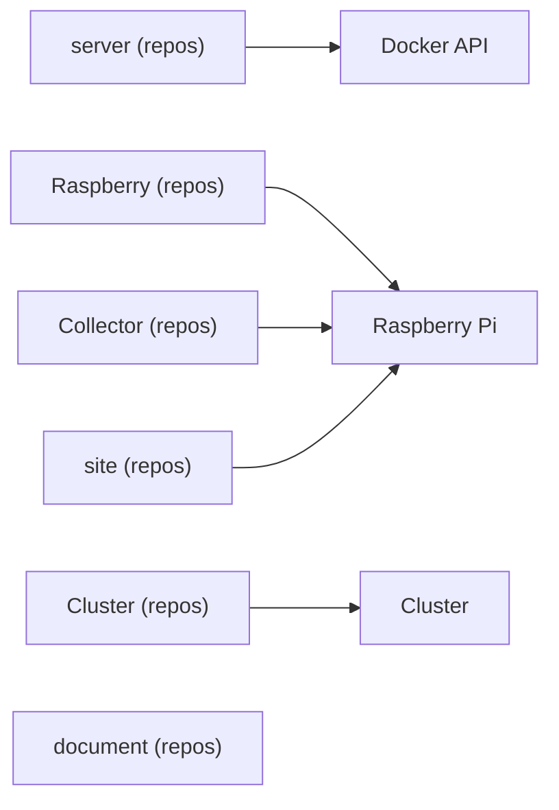

# Repositories GitHub
## <u>Organisation des repos</u>

## <u>Description</u>
- <u>**server :**</u> Repository pour l'API de retrieval. Contient les fichiers de configurations du docker, ainsi que les fichiers d'API.
- <u>**Raspberry :**</u> Repository pour la configuration générale du raspberry.
- <u>**Collector :**</u> Repository pour les scripts de collectes des repos github.
- <u>**site :**</u> Repository pour le site Web du projet.
- <u>**document :**</u> Repository pour les documents du projet.
- <u>**Cluster :**</u> Repository pour le cluster. Il contient les différents scripts pour effectuer les entrainements des modèles.

## <u>Branches</u>
- <u>**Main:**</u> Branches principales de production. Seule cette branche est déployée sur le raspberry.
- <u>**Dev:**</u> Branches secondaire permettant d'effectuer des tests avant la production. Les changements passent sur `main` via une Pull Request.
- <u>**Autres branches:**</u> Branches secondaires pour une préparation avant la dev.

Chaque push sur `main` ou `dev` déclenche la CI du repository (`.github/workflows/ci.yml`).

---
---
# Architectures des systemes
## Raspberry
- Contient les databases listées dans Database.txt.
### Fichiers
```
.
├── bin
│   ├── auth_report.sh
│   ├── backup_repos.sh
│   ├── deploy_pull.py
│   ├── export_repos.py
│   ├── heartbeat_import.py
│   ├── make_annotation_sheet.py
│   ├── make_validation_set.py
│   └── purge_chunks.py
├── Collector
│   ├── collector.py
│   ├── collector.service
│   ├── requirements.txt
│   └── state
│       ├── state.json      (reprise de la collecte)
│       └── status.json     (état affiché sur la page Système)
├── data
│   ├── judgments_9adf8ed7c8cc.json
│   └── manual_queries_v1.json
├── duckdns
│   └── duck.sh             (hors repository, contient le jeton)
├── import_runs.py
├── inspect_db.sh
├── systemd                  (tâches planifiées : *.service, *.timer, *.path)
├── setup_importer.sql, setup_retrain.sql
├── migrate_*.sql, fix_failed_runs_available.sql
├── smallbrain
│   ├── app
│   │   ├── main.py            (assemble les pages)
│   │   ├── auth.py, search.py, explore.py, distribution.py
│   │   ├── dashboard.py, monitoring.py, admin.py
│   │   ├── db.py, templating.py, model_configs.py, readme_render.py
│   │   ├── static
│   │   └── templates
│   ├── model_configs
│   ├── requirements.txt
│   └── smallbrain.service
├── tests
├── validation_archive
│   └── validation_v1-2ecf814e.json
└── venv-export
``` 

Fichiers de configuration hors repository (non versionnés, car ils contiennent des secrets):
- `/etc/smallbrain-deploy.env` : jeton GitHub du déploiement et adresse `ntfy` (lisible uniquement par root).
- `smallbrain/.env` : configuration du site (dont le jeton GitHub pour l'affichage des builds).
- `Collector/.env` : jeton GitHub du collecteur.

### Espace d'échange
Dossier partagé avec le cluster via SFTP (`/mnt/pgdata/export`, chroot de l'utilisateur `cluster`).
```
/mnt/pgdata/export
├── configs
│   └── reference            (configs de référence du cluster, lues par le site)
├── data
│   ├── manifest.json
│   ├── manual_queries.json
│   ├── repos_<date>.parquet
│   ├── validation_set.json
│   └── requests
│       ├── retrain.json     (demande en attente)
│       ├── datasets         (jeux de fine-tuning déposés depuis le site)
│       └── history          (demandes traitées)
├── heartbeat
├── inbox
├── processed
└── quarantine
```

## Cluster
### Fichiers
Cluster/
```
.
├── heartbeat.sh
├── output
│   ├── log                    (logs des jobs, non versionnés)
│   ├── model_configs
│   │   └── <10 configurations>.json
│   ├── model_configs_history
│   └── requests
│       └── <id de la demande>
├── repos_pipeline
│   ├── daily_requests.py
│   ├── eval_retrieval.py
│   ├── install_models.py
│   ├── pi_link.py
│   ├── run_pipeline.py
│   ├── submit_models.sh
│   └── weekly_run.sh
└── tests
```

Raid-etu/
```
../raid-etu
├── models
│   ├── models--Alibaba-NLP--gte-multilingual-base
│   ├── models--Alibaba-NLP--new-impl
│   ├── models--BAAI--bge-m3
│   ├── models--google--embeddinggemma-300m
│   ├── models--ibm-granite--granite-embedding-278m-multilingual
│   ├── models--intfloat--multilingual-e5-base
│   ├── models--intfloat--multilingual-e5-large-instruct
│   ├── models--intfloat--multilingual-e5-small
│   ├── models--jinaai--jina-embeddings-v3
│   ├── models--jinaai--xlm-roberta-flash-implementation
│   ├── models--nomic-ai--nomic-bert-2048
│   ├── models--nomic-ai--nomic-embed-text-v2-moe
│   ├── models--Qwen--Qwen3-Embedding-0.6B
│   ├── models--Snowflake--snowflake-arctic-embed-m-v2.0
│   ├── multilingual-e5-small
│   │   ├── 1_Pooling
│   │   │   └── config.json
│   │   ├── config.json
│   │   ├── model.safetensors
│   │   ├── modules.json
│   │   ├── onnx
│   │   │   ├── config.json
│   │   │   ├── sentencepiece.bpe.model
│   │   │   ├── special_tokens_map.json
│   │   │   ├── tokenizer_config.json
│   │   │   └── tokenizer.json
│   │   ├── sentence_bert_config.json
│   │   ├── sentencepiece.bpe.model
│   │   ├── special_tokens_map.json
│   │   ├── tokenizer_config.json
│   │   └── tokenizer.json
│   ├── promoted
│   │   └── <model_version>
│   └── save
│       └── 2026-W46
│           ├── bge-m3-5617a9f6
│           ├── e5-base-d1287505
│           ├── e5-large-instruct-274baa43
│           ├── e5-small-614241f6
│           ├── embeddinggemma-57c266a7
│           ├── granite-278m-a9cb5338
│           ├── gte-multilingual-9bbca17d
│           ├── jina-v3-ab036b02
│           ├── nomic-v2-moe-1066b659
│           └── qwen3-embedding-97b0c614
└── train
    └── temp
        ├── repos_run.2l0KVe
        │   └── out
        └── repos_run.sWCfUG
            └── out
```
## Docker API
### Fichiers
Server/
```
.
├── main.py                (API FastAPI)
├── Dockerfile             (image de l'API)
├── docker-compose.yml     (conteneurs API et SSH, volume et réseau communs)
├── .env.example           (variables du serveur)
├── ssh
│   ├── Dockerfile         (image du serveur SSH)
│   ├── sshd_config
│   └── entrypoint.sh
└── aws
    └── setup_bridge.sh    (pont WireGuard du serveur AWS)
```

## AWS
Ne sert plus que de pont : l'ancienne base PostgreSQL, l'ancien collecteur et les anciens comptes de transfert ont été supprimés.
- `jump` : utilisateur du cluster, sa clé n'autorise que des redirections vers le raspberry et le conteneur SSH du serveur.
- `~/bridge/setup_bridge.sh` et `/etc/wireguard` : tunnel WireGuard vers le serveur d'API.

## Ordinateur (développement)
- `site_local/` : environnement pour tester le site en local (base réduite, API simulée).
- `github_push` : état, commit et push de tous les repositories.
