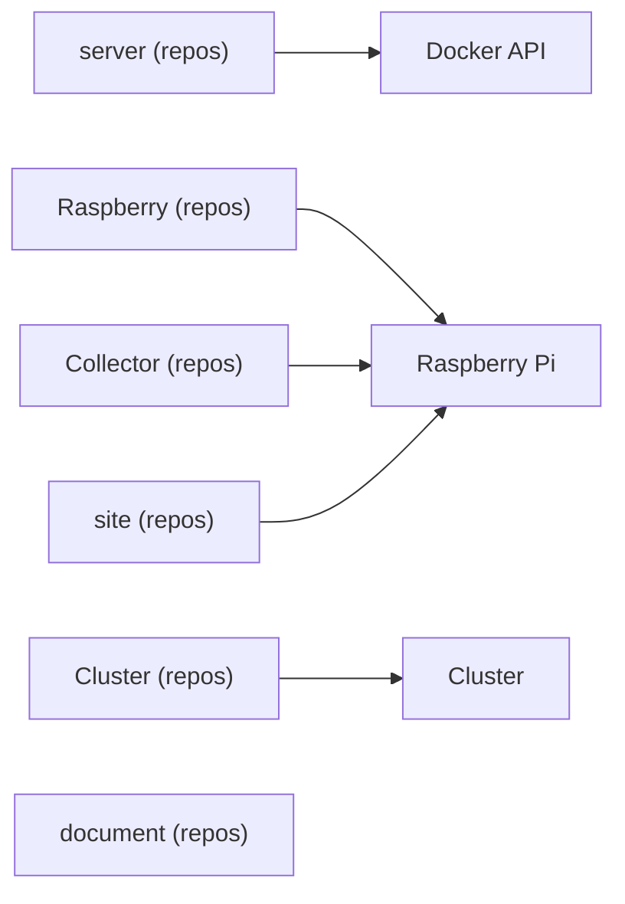

# Repositories GitHub
## <u>Organisation des repos</u>

## <u>Description</u>
- <u>**server :**</u> Repository pour l'API de retrieval. Contient les fichiers de configurations du docker, ainsi que les fichiers d'API.
- <u>**Raspberry :**</u> Repository pour la configuration générale du raspberry.
- <u>**Collector :**</u> Repository pour les scripts de collectes des repos github.
- <u>**site :**</u> Repository pour le site Web du projet.
- <u>**document :**</u> Repository pour les documents du projet.
- <u>**Cluster :**</u> Repository pour le cluster. Il contient les différents scripts pour effectuer les entrainements des modèles.

## <u>Branches</u>
- <u>**Main:**</u> Branches principales de production.
- <u>**Develop:**</u> Branches secondaire permettant d'effectuer des tests avant la production.
- <u>**Autres branches:**</u> Branches secondaires pour une préparation avant la develop.

---
---
# Architectures des systemes
## Raspberry
- Contient les databases listées dans Database.txt.
### Fichiers
```
.
├── annotation_2026-W46-pool2.html
├── backup.log
├── bin
│   ├── auth_report.sh
│   ├── backup_repos.sh
│   ├── export_repos.py
│   ├── heartbeat_import.py
│   ├── make_annotation_sheet.py
│   └── make_validation_set.py
├── Collector
├── data
│   ├── judgments_9adf8ed7c8cc.json
│   └── manual_queries_v1.json
├── duckdns
│   ├── duck.log
│   └── duck.sh
├── heartbeat_import.log
├── importer.service
├── importer.timer
├── import_runs.py
├── inspect_db.sh
├── make_annotation_sheet.py
├── manual_queries_v1.json
├── metrics_2026-W46-gemma.json
├── migrate_model_version.sql
├── output
│   └── pipeline_runs
├── setup_importer.sql
├── smallbrain
│   ├── app
│   │   ├── __init__.py
│   │   ├── main.py
│   │   ├── __pycache__
│   │   │   ├── __init__.cpython-313.pyc
│   │   │   └── main.cpython-313.pyc
│   │   ├── static
│   │   │   ├── app.js
│   │   │   ├── style.css
│   │   │   └── vendor
│   │   │       └── chart.umd.js
│   │   └── templates
│   │       ├── admin.html
│   │       ├── base.html
│   │       ├── dashboard.html
│   │       ├── data.html
│   │       ├── login.html
│   │       ├── monitoring.html
│   │       ├── search.html
│   │       └── sql.html
│   ├── model_configs
│   │   ├── bgem3.json
│   │   ├── e5base.json
│   │   ├── gemma.json
│   │   ├── jinav3.json
│   │   └── qwen3.json
│   ├── python
│   ├── README.md
│   └── requirements.txt
├── tag_language.py
├── validation_archive
│   └── validation_v1-2ecf814e.json
└── venv-export
``` 

## Cluster
### Fichiers
Cluster/
```
.
├── heartbeat.sh
├── output
│   ├── log
│   │   ├── run_all_2026-W46_3865.log
│   │   ├── run_all_3778.log
│   │   ├── run_base-e5_3889.log
│   │   ├── run_base-e5_3932.log
│   │   ├── run_base-e5_3951.log
│   │   ├── run_e5-base_3862.log
│   │   ├── run_e5-base_3863.log
│   │   ├── run_e5-base_3864.log
│   │   ├── run_e5-small_3883.log
│   │   ├── run_e5-small_3884.log
│   │   ├── run_e5-small_3885.log
│   │   ├── run_gemma_3792.log
│   │   ├── run_qwen3_3782.log
│   │   └── run_small-e5_3886.log
│   └── model_configs
│       ├── bge-m3.json
│       ├── e5-base.json
│       ├── e5-large-instruct.json
│       ├── e5-small.json
│       ├── embeddinggemma.json
│       ├── granite-278m.json
│       ├── gte-multilingual.json
│       ├── jina-v3.json
│       ├── nomic-v2-moe.json
│       └── qwen3-embedding.json
└── repos_pipeline
    ├── eval_retrieval.py
    ├── install_models.py
    ├── model_config.json
    ├── __pycache__
    │   └── eval_retrieval.cpython-312.pyc
    ├── run_pipeline.py
    ├── submit_models.sh
    └── weekly_run.sh
```

Raid-etu/
```
../raid-etu
├── models
│   ├── models--Alibaba-NLP--gte-multilingual-base
│   ├── models--Alibaba-NLP--new-impl
│   ├── models--BAAI--bge-m3
│   ├── models--google--embeddinggemma-300m
│   ├── models--ibm-granite--granite-embedding-278m-multilingual
│   ├── models--intfloat--multilingual-e5-base
│   ├── models--intfloat--multilingual-e5-large-instruct
│   ├── models--intfloat--multilingual-e5-small
│   ├── models--jinaai--jina-embeddings-v3
│   ├── models--jinaai--xlm-roberta-flash-implementation
│   ├── models--nomic-ai--nomic-bert-2048
│   ├── models--nomic-ai--nomic-embed-text-v2-moe
│   ├── models--Qwen--Qwen3-Embedding-0.6B
│   ├── models--Snowflake--snowflake-arctic-embed-m-v2.0
│   ├── multilingual-e5-small
│   │   ├── 1_Pooling
│   │   │   └── config.json
│   │   ├── config.json
│   │   ├── model.safetensors
│   │   ├── modules.json
│   │   ├── onnx
│   │   │   ├── config.json
│   │   │   ├── sentencepiece.bpe.model
│   │   │   ├── special_tokens_map.json
│   │   │   ├── tokenizer_config.json
│   │   │   └── tokenizer.json
│   │   ├── sentence_bert_config.json
│   │   ├── sentencepiece.bpe.model
│   │   ├── special_tokens_map.json
│   │   ├── tokenizer_config.json
│   │   └── tokenizer.json
│   └── save
│       └── 2026-W46
│           ├── bge-m3-5617a9f6
│           ├── e5-base-d1287505
│           ├── e5-large-instruct-274baa43
│           ├── e5-small-614241f6
│           ├── embeddinggemma-57c266a7
│           ├── granite-278m-a9cb5338
│           ├── gte-multilingual-9bbca17d
│           ├── jina-v3-ab036b02
│           ├── nomic-v2-moe-1066b659
│           └── qwen3-embedding-97b0c614
└── train
    └── temp
        ├── repos_run.2l0KVe
        │   └── out
        └── repos_run.sWCfUG
            └── out
```
## Docker API