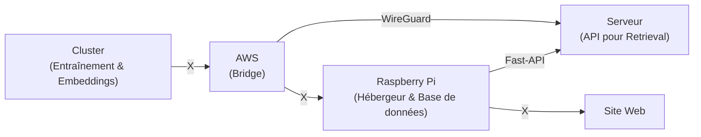

  # <u>BigData - SmallBrain </u>
  

# Projet
### <u>Groupe</u>
- Aymeric MABIRE
---
### <u>Objectif</u>
L'objectif de concevoir un outils de Retrival basé sur les ReadMe de GitHub. Son interface sera exposé sur un Site Web hebergé, et il sera possible de pouvoir choisir parmis les 3 meilleurs modèles de l'entrainement.

---
### <u>Contraintes</u>
- Le scrapping doit être effecuté de manière régulière pour conserver la base de donnée à jour.
- Les entrainements doivent être effectué de manières automatiques.
- Plusieurs modèles doivent être mis en place (MLOps).

### <u>Git</u>
- https://github.com/BigDataSmallBrain
---
# Architecture

---

### <u>Architecture API:</u> [A mettre en place]

**Système bi-conteneur:**
- API
- - Port Public 35000
- - DuckDNS (register un domain et envoyer token a Mewen)
- - 8 coeurs, 32Go RAM, GPU, 50Go (bien liberer les ressources hors stockage a la fin d'un appel API)

- SSH
- - Only key
- - Rsync plutot que SCP

Dossier en commun entre API et SSH pour le depot des models 
Acces WireGuard pour parler avec uniquement avec le conteneur SSH. 
- Cluster> SFTP > AWS > Wireguard(SSH) > SSH > Depot dans dossier communs
Attention:
- Faire attention à la configuration car Internet sera potentiellement bloqué.
---
### <u> Sécurité </u>
Une attention particulière à été prêter à la sécurité de cette architecture en respectant au mieux la règle suivante:  
"C'est le système sécurisé qui se connecte au système vulnérable et non l'inverse."  
A ces fins, le cluster se connecte via SFTP sur le raspberry pi en utilisant le serveur AWS (ouverture du port 22 avec filtre sur le AWS avec controle des IPs pour ne laisser passer que le cluster, puis tailscale entre AWS et le pi).
Le cluster sait donc se connecter successivement a l'AWS et au raspberry avec des connexions ssh, mais ni AWS ni le raspberry ne sont en mesure de se connecter au cluster.

Lors de cette connexion SFTP, le cluster ne peut lire que dans `input` et déposer ses metrics et poids dans `output`, de ce fait, il ne peut pas acceder au reste des données du raspberry, ce qui rajoute un controle supplémentaire sur les accès.

Un transfert des poids était également necessaire entre le Cluster et le Serveur API. [Inserer ici comment cela à été réaliser].

Enfin pour l'utilisation de l'API [Inserer ici comment cela à été réaliser].

---
# Base de données
Nous avons deux bases de données type PSQL sur le raspberry pour la conservation de nos données:
- Repos : Contient les repos alimenter par notre scrapping
- model_evaluations : Contient les métriques hébdomadaire par runs et par models.

Ces bases de données sont alors sauvegardé tout les samedis à 0h00.  
Seuls les 3 dernières sauvegardes sont conservés, ce qui fait un historique de 3 semaines.

## Repos
| Column | Type | Nullable | Default | Storage |
| :--- | :--- | :--- | :--- | :--- |
| id | bigint | not null | `nextval('repos_id_seq'::regclass)` | plain |
| name | text | not null | | extended |
| url | text | | | extended |
| description | text | | | extended |
| content_language | text | | | extended |
| readme_compressed | bytea | | | extended |
| readme_length | integer | | | plain |
| stars | integer | | | plain |
| forks | integer | | | plain |
| primary_language | text | | | extended |
| license | text | | | extended |
| topics | text | | | extended |
| created_at | text | | | extended |
| pushed_at | text | | | extended |
| archived | integer | | | plain |
| last_fetched_at | text | | | extended |

## Model Evaluations
Conserve l'historique hebdomadaire des évaluations de recherche par modèle et par run. 
- Mode Append-Only : Il est uniquement possible de rajouter des données, impossible de les modifier ou les ecrasers.
- Unicité : Les contraintes d'unicités empêche l'insertion des doublons dans la base.
- Entrée des donneés : L'ingestion est déclenchée chaque dimanche à 12hOO via le timer systemd `importer.timer` exécutant le service `importer.service` pour alimenter la base de données, les fichiers d'abord contenue dans `inbox` sont alors traités puis deplacer dans le dossier `processed`. 
 

| Colonne | Type PostgreSQL | Contraintes | Description |
| :--- | :--- | :--- | :--- |
| `id` | `BIGSERIAL` | `PRIMARY KEY` | Identifiant des metriques |
| `run_id` | `TEXT` | `NOT NULL UNIQUE` | Identifiant unique du run (ex. `2026-W46-gemma`) |
| `source_file` | `TEXT` | `NOT NULL UNIQUE` | Nom du fichier JSON de metriques traités |
| `run_date` | `TIMESTAMPTZ` | `NOT NULL` | Horodatage de fin d'exécution (`finished_at`, sinon `started_at`) |
| `embedding_dim` | `INTEGER` | | Dimension des vecteurs générés |
| `validation_set_version` | `TEXT` | | Version du jeu de validation utilisé |
| `corpus` | `TEXT` | | Périmètre du corpus évalué |
| `n_queries_evaluated` | `INTEGER` | | Nombre de requêtes évaluées sur le jeu de test |
| `duration_seconds` | `DOUBLE PRECISION` | | Durée totale d'exécution/entraînement sur le cluster (en secondes) |
| `bm25_recall_at_10` | `DOUBLE PRECISION` | | Score Recall@10 - recherche lexicale BM25 |
| `bm25_mrr` | `DOUBLE PRECISION` | | Score MRR - recherche lexicale BM25 |
| `bm25_ndcg_at_10` | `DOUBLE PRECISION` | | Score nDCG@10 - recherche lexicale BM25 |
| `e5_recall_at_10` | `DOUBLE PRECISION` | | Score Recall@10 - recherche dense (embeddings) |
| `e5_mrr` | `DOUBLE PRECISION` | | Score MRR - recherche dense (embeddings) |
| `e5_ndcg_at_10` | `DOUBLE PRECISION` | | Score nDCG@10 - recherche dense (embeddings) |
| `rrf_recall_at_10` | `DOUBLE PRECISION` | | Score Recall@10 - fusion hybride (*Reciprocal Rank Fusion*) |
| `rrf_mrr` | `DOUBLE PRECISION` | | Score MRR - fusion hybride (*Reciprocal Rank Fusion*) |
| `rrf_ndcg_at_10` | `DOUBLE PRECISION` | | Score nDCG@10 - fusion hybride (*Reciprocal Rank Fusion*) |
| `details` | `JSONB` | `NOT NULL DEFAULT '{}'` | Métriques détaillés : scores par tranche (`by_size`), intervalles de confiance (`ci95`) et tests appariés (`paired_diff`) |

 

---
# Scrapping
Nous utilisons l'API de GitHub afin de pouvoir récuperer des repositories correspondants à nos critères:
- README d'au moins 100 caractères
- Licence : mit, apache-2.0, bsd-3-clause, gpl-3.0, unlicense
- Langues : en ou fr
- Aucune limite d'étoiles
- 7 tranches de départ : >50 000, 10 000–50 000, 5 000–9 999, 1 000–4 999, 500–999, 100–499 et 0–99

Et lorsque ces critères sont remplis, nous collectons alors:
- Nom (clé unique)
- URL
- Description
- Langue détectée
- README (compressé en gzip)
- Longueur du README
- Etoiles
- Forks
- Langage principal
- Licence
- Topics (10 maximum)
- Date de création 
- Date de dernier commit
- Statut archivé
- Date de collecte

Les repos déjà présents sont mis à jour lorsqu'ils sont récuperer à nouveau durant le scrapping, jamais dupliqués.

L'objectif lors de cette récupération, est de collecté un maximum de données, faisant alors abstraction du nombres d'étoiles, car cela pourrait avoir son utilité à l'avenir.

Egalement, l'API de GitHub impose un nombre limité de requête par heure, et si ce nombre est dépasser, ou que trop de requête sont envoyés en un laps de temps très court, des avertissements commencent à être émits, pouvant amener à une suspension du compte. 
Pour eviter ce problème, il a été mis en place:
- **Un limiteur de débit à fenêtre glissante**, partagé entre tous les threads, qui plafonne le script à 1500 requêtes par minute, soit sous les 2000 points par minute autorisés par GitHub.
- **Une marge de sécurité sur le quota horaire** : à chaque réponse, le script lit le quota restant. Lorsqu'il passe sous un seuil (1600 points), la collecte est suspendue, puis reprend automatiquement après la réinitialisation du quota (`resetAt`) communiquée par GitHub.
- **Une gestion des erreurs avec temporisation** : si GitHub signale tout de même une limite secondaire, le script attend le délai demandé par l'API (en-tête `Retry-After`, sinon heure de reset, sinon pause croissante de 60 s, 120 s, etc.) avant de réessayer. Les erreurs réseau et serveur (502, 503, 504, timeout) sont retentées jusqu'à 5 fois avec une attente doublée à chaque tentative.

Ces différentes mesures lors du scrapping permettent ainsi une collecte efficace, tout en respectant les conditions d'utilisation de GitHub.

---
### <u>Découpage:</u>

L'API de GitHub plafonne chaque recherche à 1000 résultats. Pour contourner cette limite, l'espace de recherche est découpé en segments (tranche d'étoiles × licence × plage de dates). Lorsqu'un segment dépasse 1000 repos, il est scindé en deux sous-segments plus fins, d'abord par étoiles, puis par dates si les étoiles sont indivisibles, et ainsi de suite jusqu'à passer sous le seuil. Les sous-segments sont placés dans une file d'attente de type FILO : le dernier segment créé est le premier traité, ce qui permet de descendre un segment saturé jusqu'à ses feuilles avant d'en ouvrir un autre. La progression de chaque segment est sauvegardée pour pouvoir reprendre la collecte à tout moment.

---
### <u>Récupération:</u>

<u>**Première récupération**</u>

Dans un premier temps, au début du projet afin de se consistuer un DataWarehouse conséquent, nous avons laisser tourner la récuperation pendant 2 semaines, en récuperant des repositories depuis le début de la création de git.

<u>**Récupération lors du projet**</u>

Ensuite, lorsque nous avons collecter une grosse quantités de données (Environs 5 millions de repos), nous modifions le script de récupération, cette fois-ci, il ne récupère que sur les 5 derniers jours de modification (push, création), toujours en ignorant le nombre d'etoiles.

Nous stoppons la récuperation les Week-end, car c'est à ce moment que s'effectue la sauvegarde de la base de données et les entrainements.

# Entrainement
### <u>Données </u>
Sélections des repos ayant plus de X etoiles et X caractères dans ReadMe. 
Les données qui (voir quels données sont séléctionner) sont déposer dans un espace prévu à cet effet tout les samedi à 3h00.

Le samedi à 6h00, le cluster se connecte sur le Raspberry PI, dans l'espace SFTP, afin de récuperer les données alors déposés pour faire son entrainement.

### <u>Entrainement</u>
L'entrainement est alors inité tout les dimanches à 0h00 via un Cron. Il execute le fichier batch prévu à cet effet afin de pouvoir s'allouer un espace sur la node GPUE-07 avec 1 gpu, 8 cpu et 48G de ram. Le script est prévu de tourner 12h au maximum. L'entrainement est prévu de prendre environ 8h, afin de ne pas monopoliser le cluster, il a été decider de le faire tourner entre 0h00 et 12h. 
L'entrainement s'effectue alors avec le même jeu de donnée sur tous les modèles de notre pool models. Une fois l'entrainement effecuté, nous calculons les métriques de nos modèles que nous redéposons sur le 

### <u>Jeu de validation</u>
Le jeu de validation se compose donc de pair requête-repos avec une information sur la pertinence :
- Pertinent : Le repos corresponds parfaitement à la requête.
- Non Pertinent : Le repos ne corresponds pas à la requête (simple evocation du sujet).
- Doute : Le sujet corresponds partiellement à la requête .

Ces niveaux de pertinences permettent donc de pouvoir determiner quels repos conseillé et estimer les performances de nos modèles.

Les requêtes sont prelevés de requête type qui pourrait être utiliser par un utilisateur.

### <u>Evaluation</u>
Les modèles sont donc evaluer à partir des métriques présenter ci-dessous. Les modèles les plus performants *(ceux qui nous fournissent les résultats les plus pertinents sur les 10 premiers retours)*, sont donc transferer sur le Serveur API afin de pouvoir les mettrent à disposition des utilisateurs. 
Les modèles, à l'image de la base de données, seront donc sauvegarder pendant 3 semaines, ce qui permet d'avoir un suivis de nos performances, mais également de pouvoir recharger un ancien modèle au besoin. 
Tout les modèles sont conserver, ainsi, il sera parfaitement possible de mettre à disposition plus de modèles sans avoir à les entrainer de nouveaux. 
Les metriques alors obtenues pour chaques modeles sont déposer sur le raspberry pi via SFTP, puis sont alimentés dans la base de données metrics pour avoir une historisation claire et propre de celles ci.

---
# Interface Utilisateur [En cours]
### <u>Site Web</u>
Le site Web sert donc d'interface utilisateur de notre outils. Il offrira plusieurs possibilités:
- Consulter le Monitoring des Modeles pour voir nos performances
- Avoir un Dashboard de notre systeme
- Pouvoir envoyer une requete au modèle choisis et recevoir les 10 meilleurs repos concernant les topics
- Consulter la base de données via requête SQL et consulter ainsi les ReadMe.
- Avoir une visualisation de la distribution de nos données.
- Pouvoir effectuer un réentrainement de nos modèles (Admin).
- Ajouter des modèles pour les inférences (Admin).

---
### <u>Model Switch</u>
Il sera donc possible de pouvoir switch le modèle utiliser parmis les 3 meilleurs modèles de l'entrainement actuelle. Ces modèles seront déjà présent sur le Serveur API et seront mis à jour ou remplacer chaque semaine à la suite de l'entrainement, tout en s'assurant de la continuité de fonctionnement du service.
---
### Monitoring Models
Le but du monitoring des modèles est de pouvoir consulter rapidement les performances de nos modèles selon nos métriques. 
Il sera donc possible de pouvoir faire un réentrainement de nos modèles en cas de besoin *(entrainement journalier)*. 
---
### Dashboard système
Le Dashboard système permettra de voir l'état actuel de notre système (API, cluster, raspberry), d'avoir un temps de réponse moyen d'API et d'avoir des informations sur le versioning de l'API. 

---
# Models
### <u>intfloat/multilingual-e5-small</u>
- **Paramètres :** 118M (384 dimensions)
- **Langues supportées :** 100 langues (basé sur XLM-RoBERTa)
- **Contexte max :** 512 tokens
- **Point fort :** Extrêmement léger et rapide sur CPU, idéal pour l'indexation de gros volumes à faible coût.

---
### <u>intfloat/multilingual-e5-base</u>
- **Paramètres :** 278M (768 dimensions)
- **Langues supportées :** 100 langues
- **Contexte max :** 512 tokens
- **Point fort :** Le meilleur compromis direct de la famille E5, offrant un gain net de précision sémantique par rapport au modèle *small* tout en restant très véloce.

---
### <u>Snowflake/snowflake-arctic-embed-m-v2.0</u>
- **Paramètres :** 305M au total, dont 113M actifs hors embeddings (768 dimensions)
- **Langues supportées :** 74 langues
- **Contexte max :** 8 192 tokens
- **Point fort :** Excellentes performances sur les benchmarks de recherche (MTEB) sans sacrifier l'anglais, avec support Matryoshka (MRL) permettant de compresser les vecteurs jusqu'à 256 dimensions sans perte notable.

---
### <u>google/embeddinggemma-300m</u>
- **Paramètres :** ~300M (768 dimensions)
- **Langues supportées :** Plus de 100 langues
- **Contexte max :** 2 048 tokens
- **Point fort :** Conçu spécifiquement pour l'exécution locale (CPU, mobile, faible RAM) avec support MRL (128 à 768 dimensions) et gestion native de prompts spécialisés par tâche (recherche, code, QA).

---
### <u>nomic-ai/nomic-embed-text-v2-moe</u>
- **Paramètres :** 475M au total, dont 305M actifs à l'inférence (768 dimensions)
- **Langues supportées :** ~100 langues
- **Contexte max :** 512 tokens
- **Point fort :** Architecture *Mixture-of-Experts* (8 experts, routage top-2) offrant la qualité d'un modèle deux fois plus gros pour le coût de calcul d'un modèle moyen.

---
### <u>BAAI/bge-m3</u>
- **Paramètres :** 568M (1 024 dimensions)
- **Langues supportées :** Plus de 100 langues
- **Contexte max :** 8 192 tokens
- **Point fort :** La référence open-source pour le RAG hybride : il génère en une seule passe des vecteurs denses (sémantique), des vecteurs sparses (mots-clés type BM25) et du multi-vecteur (type ColBERT).

---
### <u>Alibaba-NLP/gte-multilingual-base</u>
- **Paramètres :** 305M (768 dimensions)
- **Langues supportées :** Plus de 70 langues
- **Contexte max :** 8 192 tokens
- **Point fort :** Très rapide à l'inférence pour un modèle à contexte long (8k), capable de produire des représentations denses élastiques et sparses pour la recherche sur documents longs.

---
### <u>Qwen/Qwen3-Embedding-0.6B</u>
- **Paramètres :** 600M (jusqu'à 1 024 dimensions)
- **Langues supportées :** Plus de 100 langues (langages naturels et langages de programmation)
- **Contexte max :** 32 768 tokens
- **Point fort :** Fenêtre de contexte massive (32k) et support des instructions personnalisées sur les requêtes (*instruction-aware*), offrant une précision de pointe sur les textes techniques, le code et les documents très longs.

---
### <u>intfloat/multilingual-e5-large-instruct</u>
- **Paramètres :** 560M (1 024 dimensions)
- **Langues supportées :** 100 langues (basé sur XLM-RoBERTa-large)
- **Contexte max :** 512 tokens
- **Point fort :** Version *instruction-tuned* la plus puissante de la famille E5 : le préfixe d'instruction sur la requête permet d'adapter finement la recherche au domaine visé (ici, la documentation de dépôts logiciels) avec une excellente précision sémantique.

---
### <u>ibm-granite/granite-embedding-278m-multilingual</u>
- **Paramètres :** 278M (768 dimensions)
- **Langues supportées :** Plus de 100 langues (dont 12 langues entraînées intensivement)
- **Contexte max :** 512 tokens
- **Point fort :** Modèle entreprise ultra-propre (licence Apache 2.0, sans code distant `trust_remote_code`), très rapide à l'inférence et spécialement optimisé pour le retrieval technique et documentaire.

---
### <u>jinaai/jina-embeddings-v3</u>
- **Paramètres :** 570M (1 024 dimensions)
- **Langues supportées :** 89 langues (plus principaux langages de programmation)
- **Contexte max :** 8 192 tokens
- **Point fort :** Utilise des adaptateurs LoRA spécialisés par tâche (retrieval, clustering, classification) et le support Matryoshka (MRL de 32 à 1 024 dimensions), offrant d'excellentes performances sur le mélange de texte naturel et de code informatique.

---
# Metrics & Méthodes :

## <u>Méthodes:</u>

### <u>BM25 :</u>

Algorithme de recherche d'information et de classement textuel basé sur le modèle probabiliste de pertinence.
Calcule un score de pertinence pour chaque document par rapport aux termes d'une requête en s'appuyant sur trois facteurs principaux.
- Fréquence des termes (Term Frequency - TF) avec saturation (k₁)
- Fréquence inverse de document (Inverse Document Frequency - IDF)
- Normalisation de la longueur du document (b) 

__Caractéristiques :__
- Recherche Lexicale (recherche de termes exacts)
- Léger et rapide
- Recherche hybride

---
### <u>E5 (EmbEddings from bidirEctional Encoder rEpresentations)</u>

Famille de modèles d'embedding de texte développée par Microsoft, basée sur des architectures Transformers (comme BERT) entraînées par apprentissage contrastif.
Transforme les requêtes et les documents en vecteurs denses pour mesurer leur proximité sémantique (via similarité cosinus).

__Caractéristiques :__
- Recherche sémantique
- Nécessite l'utilisation de préfixes spécifiques (`query: ` et `passage: `)
- Plus lourd en calcul et stockage (index vectoriel) que BM25

---
### <u>RRF (Reciprocal Rank Fusion)</u>

Algorithme de fusion de classements permettant de combiner les résultats issus de plusieurs moteurs de recherche différents (ex: BM25 + recherche vectorielle E5).
Attribue un nouveau score à chaque document selon son rang dans chaque liste, via la formule : `1 / (k + rang)` (avec `k` souvent fixé à 60).

__Caractéristiques :__
- Pilier de la recherche hybride moderne
- Indépendant des échelles de scores (additionne des rangs, pas des scores bruts incompatibles)
- Ne nécessite aucun entraînement ni réglage complexe de poids

---

## <u>Metrics</u>
### <u>Recall@10 (Rappel à 10)</u>

Métrique d'évaluation mesurant la capacité d'un système à retrouver l'ensemble des documents pertinents parmi les 10 premiers résultats retournés.
Calcul : `hits / min(10, nb pertinents)`

__Caractéristiques :__
- Mesure l'exhaustivité (ne rate pas d'infos clés)
- Ignore l'ordre de classement au sein du top 10 (le 1er vaut autant que le 10e)
- Essentiel pour evaluer un systeme de Retrival

---
### <u>MRR (Mean Reciprocal Rank)</u>

Métrique d'évaluation qui mesure à quelle vitesse le système affiche le tout premier résultat pertinent.
Calcule la moyenne de l'inverse du rang du premier document pertinent trouvé sur un ensemble de requêtes (ex: 1er = 1, 2e = 0.5, 3e = 0.33...).

__Caractéristiques :__
- Focalisé sur le premier bon résultat uniquement
- Idéal quand il n'y a qu'une seule bonne réponse attendue (ex: question-réponse factuelle)
- Très sensible aux erreurs en haut de liste

---
### <u>nDCG@10 (Normalized Discounted Cumulative Gain à 10)</u>

Métrique d'évaluation de référence qui mesure la qualité globale du classement sur les 10 premiers résultats en tenant compte à la fois du degré de pertinence et de la position.
Applique une pénalité logarithmique (Discount) aux documents pertinents qui apparaissent trop bas dans la liste, puis normalise le score entre 0 et 1 par rapport au classement idéal.

__Caractéristiques :__
- Gère la pertinence graduée (ex: pas pertinent = 0, moyen = 1, très pertinent = 2)
- Récompense fortement les meilleurs résultats placés tout en haut (rang 1, 2, 3)
- Standard industriel pour évaluer les moteurs de recherche et les modèles de Reranking
---
# Difficultés:
### <u>Matériel </u>
L'une des principales difficulté qui à été identifié concerne le materiel. En effet, dans un premier temps j'ai commencer par utiliser un serveur AWS classique (version d'essais avec X credits). Cependant, je me suis vite rendu compte que je commencais à subir un problème d'espace de stockage (30 Go) et de puissance de calcul (2 Go de Ram et 0 GPU). 
Or, si je souhaitais augmenter la puissance et l'espace que j'avais alors à disposition, il me fallait augmenter la consommation de credits (car plus gros forfait), mais après un rapide calcul en cout de credit par jour, il est apparu que je n'aurais pas assez de crédits pour tenir sur l'intégralité du temps de projet.

C'est pourquoi, je me suis tourné vers une solution local. Ayant alors un raspberry pi avec 4 Go de RAM inutilisé ainsi qu'un SSD de 2 To, j'ai remplacé le serveur AWS qui me limitait par une solution alternative, car le projet necessitait de tourner de manière continue, ce qui n'aurait pas été possible sur le cluster universitaire ni sur mon ordinateur fixe personnel.

Cependant, malgré le fait que le problème de stockage ai été résolu, il demeurait encore le problème de la puissance, car le raspberry pi ne pouvait simultanément s'occuper de l'entrainement (CPU/GPU + RAM), de l'inférence (GPU/CPU + RAM), de l'hebergement du site (CPU + RAM) et du scrapping (CPU + RAM).

Il a donc été necessaire de répartir ces différentes tâches dans différentes structures étant capable de les encaisser:
- Raspberry : Site + Scrapping (peu couteux en RAM).
- Cluster : Entrainement (Présence de puissant GPU et d'une forte capacité de calcul)
- Serveur Tiers : Inférence lors du Retrival (Puissance de calcul moyenne)
- AWS : Il ne sert que de pont de connexion entre le Cluster et le raspberry, car ne souhaitant pas exposé le port 22 de ma box personelle, et le Cluster ayant une plage de diffusion réduite.

Ainsi, les différentes tâches seraient traités par différents systèmes aux capacités différentes.

### <u>Sécurité</u>
Cependant, ce choix d'utiliser plusieurs structures pour effecuter le projet, bien que résolvant le problème initial de puissance, à également apporté un nouveau problème : la sécurité.
Effectivement, qui dit plus de point d'entrée, dit plus de faille possible. Ce qui est un gros problème si l'on sait que le Cluster ici est un cluster de calcul universitaire, et que le serveur tiers m'a été gracieusement mis à disposition pour mon API (Merci Mewen).

Il a donc été nécessaire de mettre en place des mesures de sécurités pour s'assurer que tout se déroule correctement. Ainsi, comme évoquer précédemment au point `Architecture`, il a été decider que le cluster se connecterais de lui même au raspberry pi, et que rien ne pourrait se connecter au Cluster. De ce fait, même si mon raspberry venait à être compromis, le cluster n'en serait pas inquiété.

Toutes les connexions se feraient via des protocoles sécurisés (Tailscale, SFTP, WireGuard), et chaque connexion à mon raspberry pi était alors loggé et fournit dans un rapport matinal sur mon téléphone via `ntfy`, indiquant les clés ssh utilisés pour se connectés, le nombre de connexions effectués et les commandes sudo qui ont été utilisés. 
Ce rapport, bien que informatif, me permet alors d'avoir un suivi complet de ce qu'il se passe sur le raspberry.

---
# Points à améliorer:
Voici une liste des points à améliorer que j'ai relevé durant mon projet:
- Manque de redondance des tâches : Si un de système viens à cesser de fonctionner, il n'y a rien pour le fallback.
- Manque de redondance des données : Toutes les données sont présentes uniquement sur le raspberry, si il casse, je perds tout.
- Simplifié l'architecture : Cela se réfère également au premier point, mais bien que cela puisse être interessant d'avoir une architecture complexe pour un projet universitaire, dans un cadre pratique réel, on va préféré la simplicité.
- Le jeu de donnée de validation a été réaliser par moi même, il pourrait être pertinent de recevoir l'avis de plusieurs annotateurs pour eviter les biais.

En définitive, les principaux points à améliorer sont inhérent aux choix de conceptions de l'architecture qui ont été fait.

---
**Avertissement (Disclaimer)** 
Des outils d'intelligence artificielle générative (Claude et Gemini) ont été utilisés comme assistance au développement pour certaines parties du code de ce projet. 
L'ensemble du code généré a été systématiquement relu, vérifié et testé manuellement. 
Les choix techniques, l'architecture globale ainsi que la rédaction des rapports et des livrables ont été intégralement réalisés par l'étudiant.

