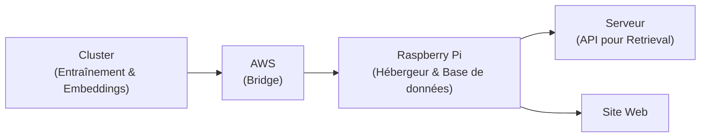

# Architecture

# Base de données
| Column | Type | Nullable | Default | Storage |
| :--- | :--- | :--- | :--- | :--- |
| id | bigint | not null | `nextval('repos_id_seq'::regclass)` | plain |
| name | text | not null | | extended |
| url | text | | | extended |
| description | text | | | extended |
| content_language | text | | | extended |
| readme_compressed | bytea | | | extended |
| readme_length | integer | | | plain |
| stars | integer | | | plain |
| forks | integer | | | plain |
| primary_language | text | | | extended |
| license | text | | | extended |
| topics | text | | | extended |
| created_at | text | | | extended |
| pushed_at | text | | | extended |
| archived | integer | | | plain |
| last_fetched_at | text | | | extended |

Base de données sauvegardé tout les samedis à 0h00.  
Seuls les 3 dernières sauvegardes sont conservés, ce qui fait un historique de 3 semaines.

# Scrapping
Nous utilisons l'API de GitHub afin de pouvoir récuperer des repositories correspondants à nos critères:
- README d'au moins 100 caractères
- Licence : mit, apache-2.0, bsd-3-clause, gpl-3.0, unlicense
- Langues : en ou fr
- Aucune limite d'étoiles
- 7 tranches de départ : >50 000, 10 000–50 000, 5 000–9 999, 1 000–4 999, 500–999, 100–499 et 0–99

Et lorsque ces critères sont remplis, nous collectons alors:
- Nom (clé unique)
- URL
- Description
- Langue détectée
- README (compressé en gzip)
- Longueur du README
- Etoiles
- Forks
- Langage principal
- Licence
- Topics (10 maximum)
- Date de création 
- Date de dernier commit
- Statut archivé
- Date de collecte

Les repos déjà présents sont mis à jour lorsqu'ils sont récuperer à nouveau durant le scrapping, jamais dupliqués.

L'objectif lors de cette récupération, est de collecté un maximum de données, faisant alors abstraction du nombres d'étoiles, car cela pourrait avoir son utilité à l'avenir.

##
### <u>Découpage:</u>

L'API de GitHub plafonne chaque recherche à 1000 résultats. Pour contourner cette limite, l'espace de recherche est découpé en segments (tranche d'étoiles × licence × plage de dates). Lorsqu'un segment dépasse 1000 repos, il est scindé en deux sous-segments plus fins, d'abord par étoiles, puis par dates si les étoiles sont indivisibles, et ainsi de suite jusqu'à passer sous le seuil. Les sous-segments sont placés dans une file d'attente de type FILO : le dernier segment créé est le premier traité, ce qui permet de descendre un segment saturé jusqu'à ses feuilles avant d'en ouvrir un autre. La progression de chaque segment est sauvegardée pour pouvoir reprendre la collecte à tout moment.

##
### Récupération

<u>**Première récupération**</u>

Dans un premier temps, au début du projet afin de se consistuer un DataWarehouse conséquent, nous avons laisser tourner la récuperation pendant 2 semaines, en récuperant des repositories depuis le début de la création de git.

<u>**Récupération lors du projet**</u>

Ensuite, lorsque nous avons collecter une grosse quantités de données (Environs 5 millions de repos), nous modifions le script de récupération, cette fois-ci, il ne récupère que sur les 5 derniers jours de modification (push, création), toujours en ignorant le nombre d'etoiles.

Nous stoppons la récuperation les Week-end, car c'est à ce moment que s'effectue la sauvegarde de la base de données et les entrainements.

# Entrainement
## Données
Sélections des repos ayant plus de X etoiles et X caractères dans ReadMe. 
Les données qui (voir quels données sont séléctionner) sont déposer dans un espace prévu à cet effet tout les samedi à 3h00.

Le samedi à 6h00, le cluster se connecte sur le Raspberry PI, dans l'espace SFTP, afin de récuperer les données alors déposés pour faire son entrainement.

## Entrainement
L'entrainement est alors inité tout les samedis à 6h00 via un Cron. Il execute le fichier batch prévu à cet effet afin de pouvoir s'allouer un espace sur la node GPUE-07 avec 1 gpu, 8 cpu et 48G de ram. Le script est prévu de tourner 6h au maximum.  

# Models

### <u>intfloat/multilingual-e5-small</u>
- **Paramètres :** 118M (384 dimensions)
- **Langues supportées :** 100 langues (basé sur XLM-RoBERTa)
- **Contexte max :** 512 tokens
- **Point fort :** Extrêmement léger et rapide sur CPU, idéal pour l'indexation de gros volumes à faible coût.

##
### <u>intfloat/multilingual-e5-base</u>
- **Paramètres :** 278M (768 dimensions)
- **Langues supportées :** 100 langues
- **Contexte max :** 512 tokens
- **Point fort :** Le meilleur compromis direct de la famille E5, offrant un gain net de précision sémantique par rapport au modèle *small* tout en restant très véloce.

##
### <u>Snowflake/snowflake-arctic-embed-m-v2.0</u>
- **Paramètres :** 305M au total, dont 113M actifs hors embeddings (768 dimensions)
- **Langues supportées :** 74 langues
- **Contexte max :** 8 192 tokens
- **Point fort :** Excellentes performances sur les benchmarks de recherche (MTEB) sans sacrifier l'anglais, avec support Matryoshka (MRL) permettant de compresser les vecteurs jusqu'à 256 dimensions sans perte notable.

##
### <u>google/embeddinggemma-300m</u>
- **Paramètres :** ~300M (768 dimensions)
- **Langues supportées :** Plus de 100 langues
- **Contexte max :** 2 048 tokens
- **Point fort :** Conçu spécifiquement pour l'exécution locale (CPU, mobile, faible RAM) avec support MRL (128 à 768 dimensions) et gestion native de prompts spécialisés par tâche (recherche, code, QA).

##
### <u>nomic-ai/nomic-embed-text-v2-moe</u>
- **Paramètres :** 475M au total, dont 305M actifs à l'inférence (768 dimensions)
- **Langues supportées :** ~100 langues
- **Contexte max :** 512 tokens
- **Point fort :** Architecture *Mixture-of-Experts* (8 experts, routage top-2) offrant la qualité d'un modèle deux fois plus gros pour le coût de calcul d'un modèle moyen.

##
### <u>BAAI/bge-m3</u>
- **Paramètres :** 568M (1 024 dimensions)
- **Langues supportées :** Plus de 100 langues
- **Contexte max :** 8 192 tokens
- **Point fort :** La référence open-source pour le RAG hybride : il génère en une seule passe des vecteurs denses (sémantique), des vecteurs sparses (mots-clés type BM25) et du multi-vecteur (type ColBERT).

##
### <u>Alibaba-NLP/gte-multilingual-base</u>
- **Paramètres :** 305M (768 dimensions)
- **Langues supportées :** Plus de 70 langues
- **Contexte max :** 8 192 tokens
- **Point fort :** Très rapide à l'inférence pour un modèle à contexte long (8k), capable de produire des représentations denses élastiques et sparses pour la recherche sur documents longs.

##
### <u>Qwen/Qwen3-Embedding-0.6B</u>
- **Paramètres :** 600M (jusqu'à 1 024 dimensions)
- **Langues supportées :** Plus de 100 langues (langages naturels et langages de programmation)
- **Contexte max :** 32 768 tokens
- **Point fort :** Fenêtre de contexte massive (32k) et support des instructions personnalisées sur les requêtes (*instruction-aware*), offrant une précision de pointe sur les textes techniques, le code et les documents très longs.

# Metrics & Méthodes :

## Méthodes:

### <u>BM25 :</u>

Algorithme de recherche d'information et de classement textuel basé sur le modèle probabiliste de pertinence.
Calcule un score de pertinence pour chaque document par rapport aux termes d'une requête en s'appuyant sur trois facteurs principaux.
- Fréquence des termes (Term Frequency - TF) avec saturation (k₁)
- Fréquence inverse de document (Inverse Document Frequency - IDF)
- Normalisation de la longueur du document (b) 

__Caractéristiques :__
- Recherche Lexicale (recherche de termes exacts)
- Léger et rapide
- Recherche hybride

##
### <u>E5 (EmbEddings from bidirEctional Encoder rEpresentations)</u>

Famille de modèles d'embedding de texte développée par Microsoft, basée sur des architectures Transformers (comme BERT) entraînées par apprentissage contrastif.
Transforme les requêtes et les documents en vecteurs denses pour mesurer leur proximité sémantique (via similarité cosinus).

__Caractéristiques :__
- Recherche sémantique
- Nécessite l'utilisation de préfixes spécifiques (`query: ` et `passage: `)
- Plus lourd en calcul et stockage (index vectoriel) que BM25

##
### <u>RRF (Reciprocal Rank Fusion)</u>

Algorithme de fusion de classements permettant de combiner les résultats issus de plusieurs moteurs de recherche différents (ex: BM25 + recherche vectorielle E5).
Attribue un nouveau score à chaque document selon son rang dans chaque liste, via la formule : `1 / (k + rang)` (avec `k` souvent fixé à 60).

__Caractéristiques :__
- Pilier de la recherche hybride moderne
- Indépendant des échelles de scores (additionne des rangs, pas des scores bruts incompatibles)
- Ne nécessite aucun entraînement ni réglage complexe de poids

##

## Metrics

### <u>Recall@10 (Rappel à 10)</u>

Métrique d'évaluation mesurant la capacité d'un système à retrouver l'ensemble des documents pertinents parmi les 10 premiers résultats retournés.
Calcul : `hits / min(10, nb pertinents)`

__Caractéristiques :__
- Mesure l'exhaustivité (ne rate pas d'infos clés)
- Ignore l'ordre de classement au sein du top 10 (le 1er vaut autant que le 10e)
- Essentiel pour evaluer un systeme de Retrival

##
### <u>MRR (Mean Reciprocal Rank)</u>

Métrique d'évaluation qui mesure à quelle vitesse le système affiche le tout premier résultat pertinent.
Calcule la moyenne de l'inverse du rang du premier document pertinent trouvé sur un ensemble de requêtes (ex: 1er = 1, 2e = 0.5, 3e = 0.33...).

__Caractéristiques :__
- Focalisé sur le premier bon résultat uniquement
- Idéal quand il n'y a qu'une seule bonne réponse attendue (ex: question-réponse factuelle)
- Très sensible aux erreurs en haut de liste

##
### <u>nDCG@10 (Normalized Discounted Cumulative Gain à 10)</u>

Métrique d'évaluation de référence qui mesure la qualité globale du classement sur les 10 premiers résultats en tenant compte à la fois du degré de pertinence et de la position.
Applique une pénalité logarithmique (Discount) aux documents pertinents qui apparaissent trop bas dans la liste, puis normalise le score entre 0 et 1 par rapport au classement idéal.

__Caractéristiques :__
- Gère la pertinence graduée (ex: pas pertinent = 0, moyen = 1, très pertinent = 2)
- Récompense fortement les meilleurs résultats placés tout en haut (rang 1, 2, 3)
- Standard industriel pour évaluer les moteurs de recherche et les modèles de Reranking